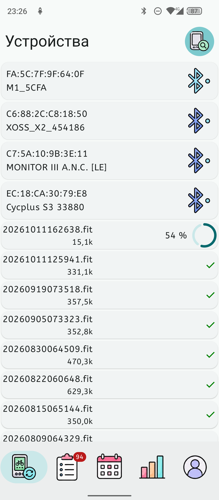

# cycoffline
Данное приложение написано под Android.
Основные функции:
- загрузка тренировок в виде файлов формата fit или по bluetooth с велокомпьютера cycplus (тестировал с версией M1)
- просмотр показателей тренировок
- отслеживание динамики прогресса и выполненного тренировочного объема

|||
|:---:|:---:|
||fdsafdsf|
