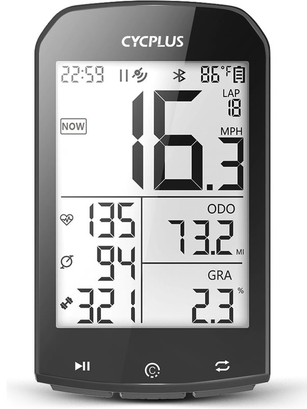
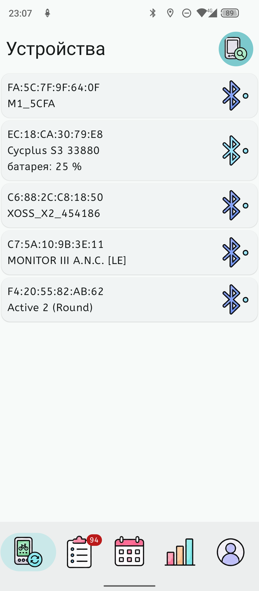
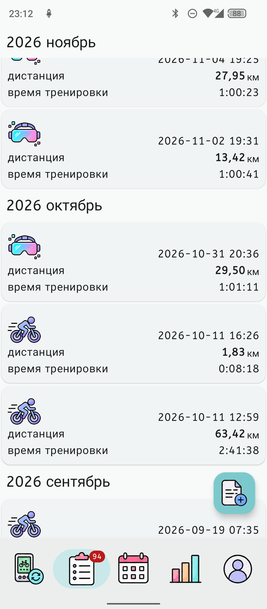
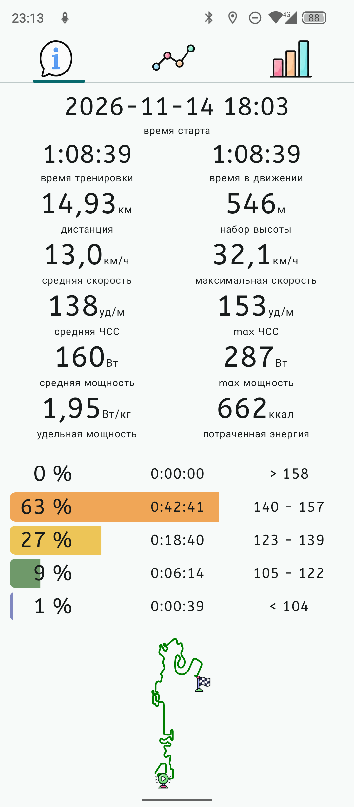
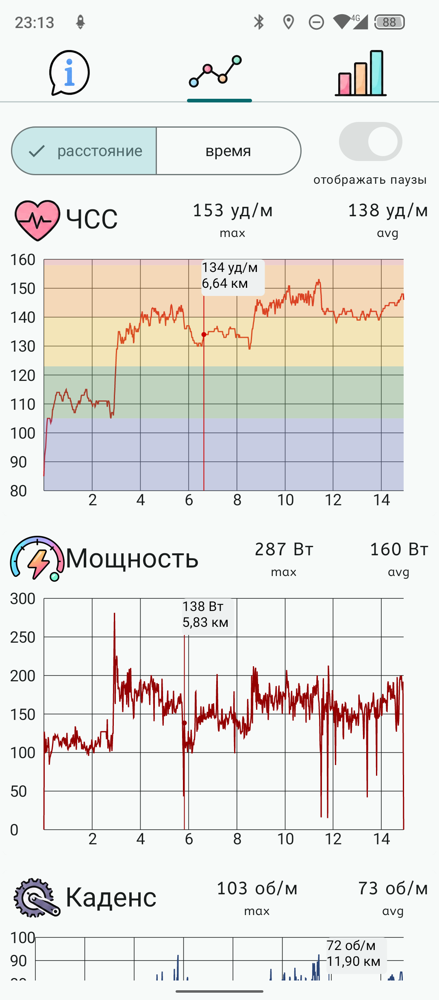
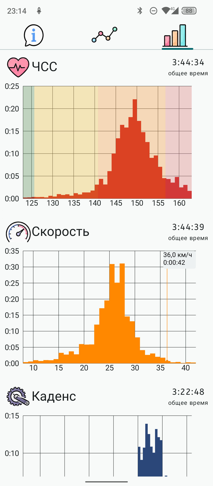
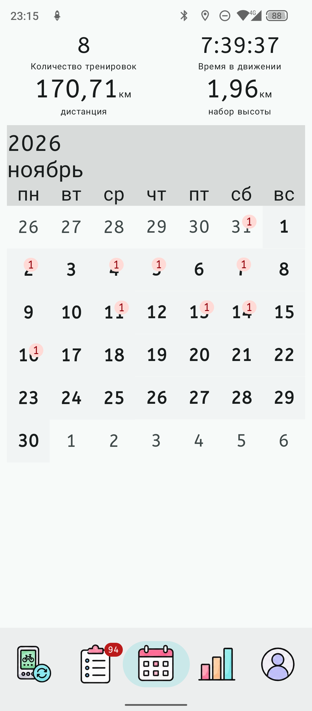
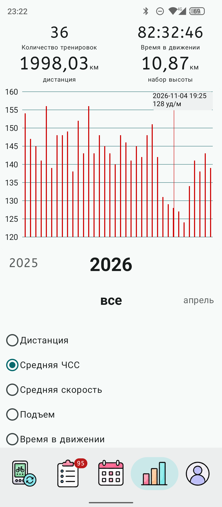
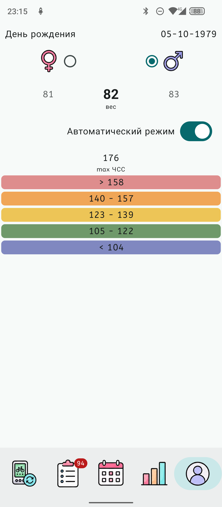

# Основные задачи проекта
Создать приложение для анализа велотренировок, которое работает максимально автономно,
Реализовать загрузку файлов тренировок непосредственно с велокомпьютера.

# Описание
Программа разработана под Android.
Загрузка тренировок реализована или в виде файлов формата .fit или с велокомпьютеров Сycplus M1

## Устройства
На данном экране можно выполнить поиск устройст с поддержкой BLE, и сохранить их в списке для последующей работы.
Можно добавить не только велокомпьютер, но и датчики (датчик каденса, пульса, мощности и в принципе любые устройства BLE, например наушники).
Долгое нажатие в списке на велокомпьютере загружает список тренировок, записанных в памяти велокомпьютера,
на датчике, получает информацию о заряде батареи датчика.

 

## Список тренировок
Отображается список тренировк с краткой информацией. Символ "велосипед" или "виртуальные очки", показыает тип тренировки, реальная тренировка или на станке.

### Тренировка
Общая информация о тренировке. Графики можно переключать в режим отображения по расстоянию или времени. На графиках ЧСС пульсовые зоны отмечены цветом фона. Последний экран отображает нормальное распределение отслеживаемой характеристики по времени. Количество и тип отображаемых графиков зависит от информации записаной в файле тренировки.

   

## Календарь
Итоговый объем тренировок за месяц и распределение тренировк по дням. При нажатии на день переходим к тренировке.

## Статистика
Отображение общей статистики за указанный период (можно выбрать год и месяц) и динамики изменения выбранного показателя. К любой тренировке можно перейти нажав на всплывающую подсказку.

## Настройка
На данном экране можно задать возраст, максимальную ЧСС, по которой будут потом определяться пульсовые зоны, а так же вес, для определения удельной мощности.

